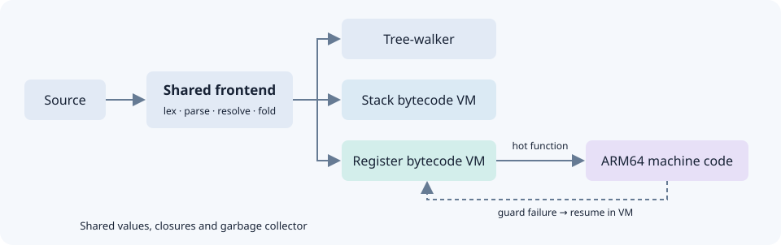
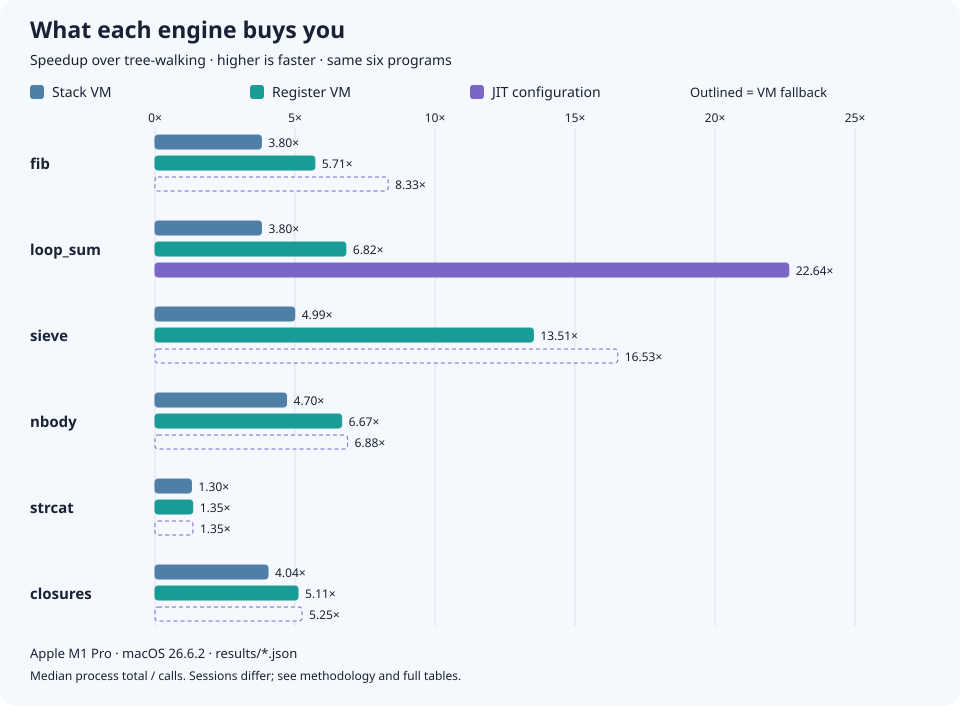

# Rung

[](https://github.com/aadityad12/rung/actions/workflows/ci.yml)
[](LICENSE)

**One small language. A ladder from tree-walking to handwritten ARM64 machine code.**

Rung is a dynamically typed language built in C++20 to answer a specific question: how much
is each classic interpreter optimization actually worth? The same programs run through a
tree-walker, two bytecode VMs, and an ARM64 JIT with optional background compilation. Every
configuration must preserve the output; the benchmark ladder measures what changes in speed.

**[Download](https://github.com/aadityad12/rung/releases/latest)** · **[Run the demo](#try-it)** · **[How it works](docs/architecture.md)** ·
**[Results](#results)** · **[Build & install](docs/install.md)** · **[CLI reference](docs/cli.md)**

## Watch it run

A hot function becomes machine code. A float then fails an integer type guard, and the VM
finishes the call with the right answer.


Real command output, generated automatically. Playback is paced for reading; compile durations
and build-dependent native code sizes are omitted. [Still image](docs/assets/jit.png) · [Text transcript](docs/assets/demo-transcript.md)

<details>
<summary><strong>Same program across five configurations</strong></summary>


The tour checks both answers on every available configuration. Background compilation may
finish before or after a call; either schedule must preserve the output.
[Example source](examples/hot_loop.rg) · [Still image](docs/assets/engines.png)

</details>

<details>
<summary><strong>Stack versus register bytecode</strong></summary>


The stack VM pushes its operands. The register VM names them directly in one instruction.
These are actual disassembly excerpts; both programs print `42`.
[Example source](examples/bytecode.rg) · [Still image](docs/assets/bytecode.png)

</details>

<details>
<summary><strong>Recursive machine code and a bailout four calls deep</strong></summary>


The JIT calls its own ARM64 entry for `fib`. A second example passes a float to the bottom of
four recursive calls; the VM resumes there and finishes every suspended caller.
[Examples and explanation](docs/demo.md#recursive-calls-and-nested-fallback) ·
[Still image](docs/assets/recursion.png)

</details>

## Try it

**Without a compiler:** [download v0.1.0](https://github.com/aadityad12/rung/releases/tag/v0.1.0)
for macOS ARM64 or Linux ARM64/x86-64. Extract it, then run `./bin/rung --version`.
[Run the packaged tour](docs/install.md#portable-archives). The release includes the original
JIT demo; the recursion demo requires a source build of this revision.

For a source build, you need **CMake 3.25+, Ninja, Clang with C++20, and Python 3.9+**.
[Platform setup, Docker and installation instructions](docs/install.md).

```sh
git clone https://github.com/aadityad12/rung.git
cd rung
cmake --preset debug && cmake --build --preset debug
./build/debug/rung examples/fib.rg                       # 6765
python3 scripts/demo.py --rung build/debug/rung           # checked, guided tour
ctest --preset debug                                    # full correctness suite
```

On ARM64, enable the JIT for the complete tour:

```sh
cmake --preset release-goto-nanbox && cmake --build --preset release-goto-nanbox
python3 scripts/demo.py --rung build/release-goto-nanbox/rung
```

The tour checks engine agreement, shows bytecode, and verifies JIT compilation and fallback.
Unsupported JIT demos are explicitly skipped. `rung --help` explains usage; `rung --version`
lists the engines in that build. [Run individual demo sections or regenerate the clips](docs/demo.md).

## The engineering



- **A shared runtime:** wrapping int32 arithmetic, floats, interned strings, arrays, closures
  and a precise mark-sweep collector. All engines share the language's semantics and errors.
- **A measurable optimization ladder:** bytecode, computed-goto dispatch, NaN-boxing,
  register instructions, superinstructions, global inline caches and constant folding.
- **A handwritten ARM64 JIT:** instruction encodings checked against LLVM assembler output,
  type guards, array access, recursive calls that push the VM's own call frames, and fallback to
  the exact bytecode instruction that failed, even several calls deep.
- **A background compiler:** release/acquire publication, instruction-cache synchronization,
  and GC roots that keep queued functions alive. Tested under ThreadSanitizer.
- **Correctness across configurations:** conformance programs, unit tests, forced GC,
  ASan/UBSan, frontend fuzzing, and CI on macOS ARM64, Linux ARM64 and Linux x86-64.

The interpreter foundations follow *Crafting Interpreters* and Lua 5.0. The optimization
experiments, handwritten JIT, background compilation and measurement pipeline extend that
foundation. [Architecture and design decisions](docs/architecture.md) · [Testing](docs/testing.md)

## Results



The JIT now compiles functions in **two of the six main benchmarks: `fib` and `loop_sum`**.
In the same interleaved session, native recursion made `fib` **4.54× faster than the optimized
register VM** (13.37 ms → 2.94 ms, median process total divided by calls).
Outlined bars show VM fallback, not native-code performance.

The ladder includes every regression, including NaN-boxing slowing all six benchmarks.
Results come from one M1 Pro. Rows `08_fold`, `09_jit` and the background pair were measured
together; comparisons against earlier rows, including the tree-walker, span sessions.

**Read the investigations:** [why register bytecode dispatches fewer instructions](docs/performance.md#one-rung-up-close-stack-vm-to-register-vm),
[what surprised me](docs/performance.md#what-surprised-me), and
[methodology and limitations](docs/performance.md).

<details>
<summary>Generated numerical summary</summary>

<!-- summary:start -->
_Generated by `scripts/ladder.py` from `results/`, measured on Apple M1 Pro, macOS 26.6.2; median process total divided by calls._ `02_stack` Stack VM (switch dispatch, tagged values): 1.30× (`strcat`) to 4.99× (`sieve`) the speed of `01_tree` Tree-walker. `09_jit` + baseline JIT: 1.39× (`strcat`) to 38.84× (`fib`) the speed of `01_tree` Tree-walker. The largest loss from a single rung is `04_nanbox` on `sieve`: 0.63× the speed of the row before it.
<!-- summary:end -->

</details>

<details>
<summary>Full benchmark tables, regressions and provenance</summary>

<!-- ladder:start -->
_This section is generated by `scripts/ladder.py` from the files in `results/`. Do not edit it by hand: `ladder.py --check` runs in CI and fails if it differs._

**Speedup over `01_tree`** (median process total divided by calls per process; higher is faster):

| Configuration | fib | loop_sum | sieve | nbody | strcat | closures | warmup |
| --- | --- | --- | --- | --- | --- | --- | --- |
| `01_tree` Tree-walker | 1.00× | 1.00× | 1.00× | 1.00× | 1.00× | 1.00× | n/a |
| `02_stack` Stack VM (switch dispatch, tagged values) | 3.80× | 3.80× | 4.99× | 4.70× | 1.30× | 4.04× | n/a |
| `03_goto` + computed-goto dispatch | 4.53× | 5.22× | 9.04× | 6.17× | 1.33× | 4.66× | n/a |
| `04_nanbox` + NaN-boxed values | 4.06× | 3.89× | 5.72× | 4.80× | 1.31× | 4.25× | n/a |
| `05_register` Register VM | 5.71× | 6.82× | 13.51× | 6.67× | 1.35× | 5.11× | n/a |
| `06_super` + superinstructions | 5.76× | 10.22× | 16.81× | 6.95× | 1.35× | 5.34× | n/a |
| `07_ic` + inline caching for globals | 8.41× | 7.03× † | 16.84× | 6.96× | 1.35× | 5.21× | n/a |
| `08_fold` + constant folding / dead-code elimination | 8.55× | 9.90× | 16.52× | 6.89× | 1.38× | 5.39× | n/a |
| `09_jit` + baseline JIT | 38.84× | 22.38× | 16.15× ‡ | 6.87× ‡ | 1.39× ‡ | 5.29× ‡ | n/a |

**Marginal speedup over the previous row:**

| Configuration | fib | loop_sum | sieve | nbody | strcat | closures | warmup |
| --- | --- | --- | --- | --- | --- | --- | --- |
| `01_tree` Tree-walker | — | — | — | — | — | — | — |
| `02_stack` Stack VM (switch dispatch, tagged values) | 3.80× | 3.80× | 4.99× | 4.70× | 1.30× | 4.04× | n/a |
| `03_goto` + computed-goto dispatch | 1.19× | 1.37× | 1.81× | 1.31× | 1.03× | 1.15× | n/a |
| `04_nanbox` + NaN-boxed values | **0.90× ▼** | **0.74× ▼** | **0.63× ▼** | **0.78× ▼** | **0.98× ▼** | **0.91× ▼** | n/a |
| `05_register` Register VM | 1.41× | 1.75× | 2.36× | 1.39× | 1.03× | 1.20× | n/a |
| `06_super` + superinstructions | 1.01× | 1.50× | 1.24× | 1.04× | 1.00× | 1.04× | n/a |
| `07_ic` + inline caching for globals | 1.46× | **0.69× ▼** † | 1.00× | 1.00× | **1.00× ▼** | **0.98× ▼** | n/a |
| `08_fold` + constant folding / dead-code elimination | 1.02× | 1.41× † | **0.98× ▼** | **0.99× ▼** | 1.03× | 1.04× | n/a |
| `09_jit` + baseline JIT | 4.54× | 2.26× | **0.98× ▼** ‡ | **1.00× ▼** ‡ | 1.00× ‡ | **0.98× ▼** ‡ | 1.69× |

**p99 time of one `run()` call** (nearest-rank, over every measured call of every run pooled; lower is better):

| Configuration | fib | loop_sum | sieve | nbody | strcat | closures | warmup |
| --- | --- | --- | --- | --- | --- | --- | --- |
| `01_tree` Tree-walker | 115.47 ms | 310.22 ms | 284.47 ms | 230.46 ms | 186.70 ms | 243.56 ms | n/a |
| `02_stack` Stack VM (switch dispatch, tagged values) | 30.80 ms | 79.23 ms | 56.66 ms | 49.41 ms | 144.62 ms | 61.05 ms | n/a |
| `03_goto` + computed-goto dispatch | 26.18 ms | 57.85 ms | 31.24 ms | 37.48 ms | 140.90 ms | 53.28 ms | n/a |
| `04_nanbox` + NaN-boxed values | 29.53 ms | 77.56 ms | 49.22 ms | 48.75 ms | 143.42 ms | 57.60 ms | n/a |
| `05_register` Register VM | 21.09 ms | 46.15 ms | 20.81 ms | 35.41 ms | 139.62 ms | 48.07 ms | n/a |
| `06_super` + superinstructions | 21.19 ms | 32.06 ms | 16.75 ms | 33.77 ms | 139.31 ms | 46.24 ms | n/a |
| `07_ic` + inline caching for globals | 13.82 ms | 43.36 ms † | 17.05 ms | 34.07 ms | 139.81 ms | 49.12 ms | n/a |
| `08_fold` + constant folding / dead-code elimination | 17.03 ms | 31.92 ms | 17.63 ms | 34.48 ms | 144.82 ms | 52.91 ms | 0.32 ms |
| `09_jit` + baseline JIT | 3.04 ms | 38.41 ms | 19.85 ms ‡ | 34.02 ms ‡ | 152.28 ms ‡ | 50.67 ms ‡ | 0.88 ms |

**JIT compile time per process** (median over the runs of the total time the JIT spent deciding on and compiling functions in one process, rejected ones included; in parentheses, its share of the median total time of the timed calls):

| Configuration | fib | loop_sum | sieve | nbody | strcat | closures | warmup |
| --- | --- | --- | --- | --- | --- | --- | --- |
| `09_jit` + baseline JIT | 21.2 µs (0.036%) | 17.0 µs (0.0064%) | 2.6 µs (0.00076%) ‡ | 2.2 µs (0.00033%) ‡ | 1.8 µs (0.000066%) ‡ | 2.8 µs (0.00030%) ‡ | 579.7 µs (19%) |

**Background compilation** (notes D8): `jit_sync` (the JIT compiling on the engine's thread, row 09's arguments) against `jit_background` (the same with `--jit-background`). These are not ladder rows. Time of one `run()` call, p50 / p99 / max in ms, nearest-rank over every measured call of every run pooled; lower is better. Measured in one `bench.py` invocation, so interleaved (notes D5) and comparable call for call.

| Benchmark | `jit_sync` p50 | `jit_sync` p99 | `jit_sync` max | `jit_background` p50 | `jit_background` p99 | `jit_background` max |
| --- | --- | --- | --- | --- | --- | --- |
| `fib` | 2.94 | 3.10 | 3.12 | 2.92 | 3.08 | 3.17 |
| `loop_sum` | 12.12 | 38.71 | 40.88 | 12.12 | 40.06 | 40.41 |
| `sieve` ‡ | 16.72 | 17.54 | 17.76 | 16.71 | 17.88 | 18.21 |
| `nbody` ‡ | 33.26 | 34.41 | 68.07 | 33.32 | 34.47 | 35.03 |
| `strcat` ‡ | 132.85 | 140.58 | 163.27 | 132.96 | 138.93 | 141.10 |
| `closures` ‡ | 45.58 | 48.69 | 49.01 | 45.56 | 47.51 | 48.10 |
| `warmup` | 0.09 | 0.89 | 1.05 | 0.09 | 0.28 | 0.34 |

**Provenance** (from `meta` in each results file):

| Configuration | Commit | Date | Machine | Power | Measured |
| --- | --- | --- | --- | --- | --- |
| `01_tree` Tree-walker | `e618db54a8` | 2026-10-07 | Apple M1 Pro, macOS 26.6.2 | AC power | 10 runs of 20 calls |
| `02_stack` Stack VM (switch dispatch, tagged values) | `e618db54a8` | 2026-10-07 | Apple M1 Pro, macOS 26.6.2 | AC power | 10 runs of 20 calls |
| `03_goto` + computed-goto dispatch | `e618db54a8` | 2026-10-07 | Apple M1 Pro, macOS 26.6.2 | AC power | 10 runs of 20 calls |
| `04_nanbox` + NaN-boxed values | `e618db54a8` | 2026-10-07 | Apple M1 Pro, macOS 26.6.2 | AC power | 10 runs of 20 calls |
| `05_register` Register VM | `e618db54a8` | 2026-10-07 | Apple M1 Pro, macOS 26.6.2 | AC power | 10 runs of 20 calls |
| `06_super` + superinstructions | `e618db54a8` | 2026-10-07 | Apple M1 Pro, macOS 26.6.2 | AC power | 10 runs of 20 calls |
| `07_ic` + inline caching for globals | `0d05a706c5` | 2026-10-07 | Apple M1 Pro, macOS 26.6.2 | AC power | 10 runs of 20 calls |
| `08_fold` + constant folding / dead-code elimination | `358efb83c1` | 2026-10-19 | Apple M1 Pro, macOS 26.6.2 | AC power | 10 runs of 20 calls |
| `09_jit` + baseline JIT | `358efb83c1` | 2026-10-19 | Apple M1 Pro, macOS 26.6.2 | AC power | 10 runs of 20 calls |
| `jit_sync` the JIT compiling on the engine's thread, row 09's arguments | `358efb83c1` | 2026-10-19 | Apple M1 Pro, macOS 26.6.2 | AC power | 10 runs of 20 calls |
| `jit_background` the same with `--jit-background` | `358efb83c1` | 2026-10-19 | Apple M1 Pro, macOS 26.6.2 | AC power | 10 runs of 20 calls |

▼ marks a configuration slower than the one it is compared with. † marks a cell where the spread (IQR) of the per-run totals exceeded 5% of their median in at least one of the two runs compared, so the figure is uncertain and the row should be re-measured.

‡ marks a JIT row's cell for a benchmark in which the JIT compiled no function at its default threshold in the measured revision, so the row measures the register VM plus the JIT's hotness counting, not machine code (notes D7, D16; coverage from the measurement metadata or `bench/jit_coverage_history.json`). Current compiler coverage is checked separately against `bench/jit_not_compiled.json`. Why: `sieve`: `run` is rejected (it calls the global `array`); `nbody`: `root` is rejected (a float constant), `advance` and `run` (globals); `strcat`: `run` is rejected (a string constant); `closures`: `run` is rejected (a global), `make_adder` (it creates a closure), `add` and `next` (captured variables).
<!-- ladder:end -->

</details>

Tables and the chart are generated from committed `results/*.json`; CI checks both for drift.
[Reproduce the numbers](docs/performance.md#reproducing-the-numbers).

## Scope and next questions

The language is deliberately small: first-class functions and closures, fixed-size arrays,
strings, numbers, conditionals and loops. [Language rules](docs/architecture.md#the-language).

The JIT supports integer operations, control flow, array access, and a function calling itself
(which is how `fib` compiles). Other calls, globals, floats, strings and closures stay in the VM;
there is no on-stack replacement. Both JIT modes require
ARM64. The three interpreters also run on Linux x86-64. The NaN-boxing regression and
`loop_sum` timing groups are still unexplained. [Full limitations](docs/performance.md#limitations-and-what-id-do-next).

## Acknowledgements

- Robert Nystrom, [*Crafting Interpreters*](https://craftinginterpreters.com/). The tree-walker
  follows `jlox`: environments as garbage-collected hash maps, and variable uses resolved to a
  number of hops beforehand. The stack VM and its compiler follow `clox` closely: local slots,
  scope tracking, upvalue resolution and jump patching in the compiler; the dispatch loop, calls,
  returns and closures in the VM; and the disassembler's layout. Anything that looks like `clox`
  probably is. The parser's precedence climbing is the same idea as `clox`'s Pratt parser,
  written as a table and a loop. The NaN-boxed value follows the book's optimization chapter too,
  with an int32 tag added.
- Roberto Ierusalimschy, Luiz Henrique de Figueiredo and Waldemar Celes,
  [*The Implementation of Lua 5.0*](https://www.lua.org/doc/jucs05.pdf) (2005). The register VM
  is based on it: locals in fixed registers with temporaries above them, the calling convention,
  one register file with each call frame a window into it, and building long array literals in
  batches the way Lua's `SETLIST` does.
- The JIT uses the standard ARM64 calling convention (AAPCS64). Its instruction encoder is
  hand-written; the LLVM assembler is used only to generate the table its tests check against,
  and is not a dependency.
- Everything past the register VM, the JIT and background compilation, goes beyond both.
- [doctest](https://github.com/doctest/doctest), vendored in `third_party/`, runs the unit tests.

## License

MIT. See [LICENSE](LICENSE). The vendored doctest is also MIT.
