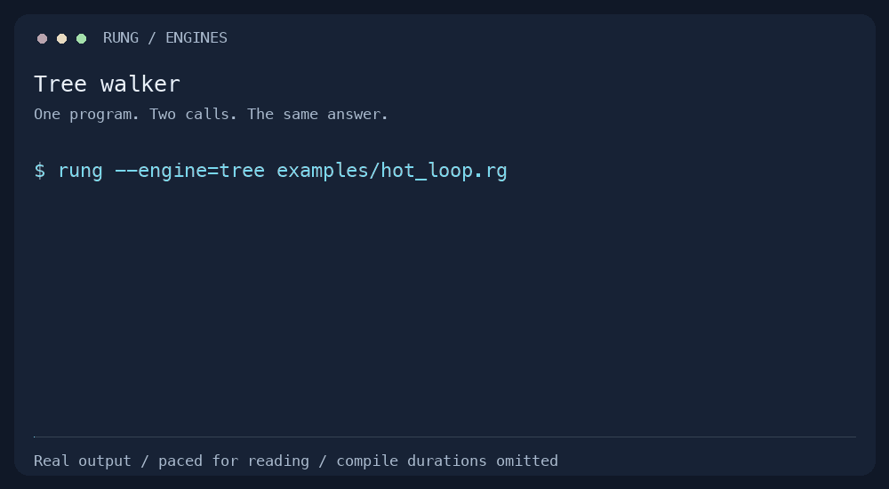
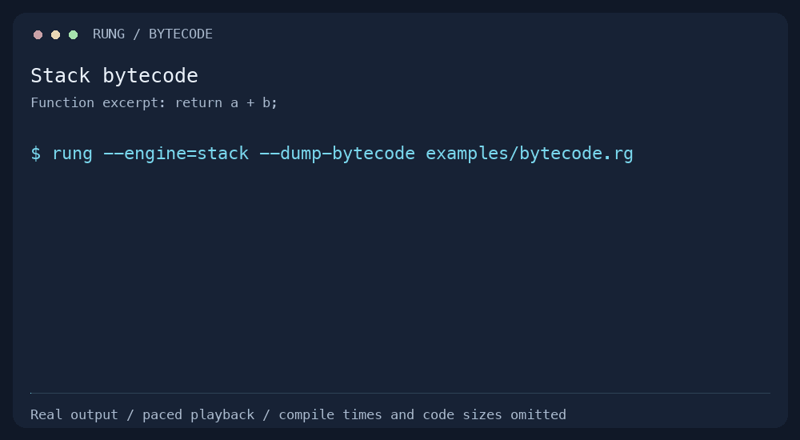
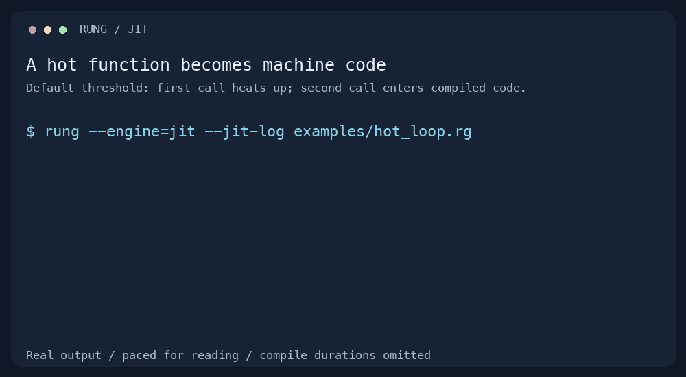
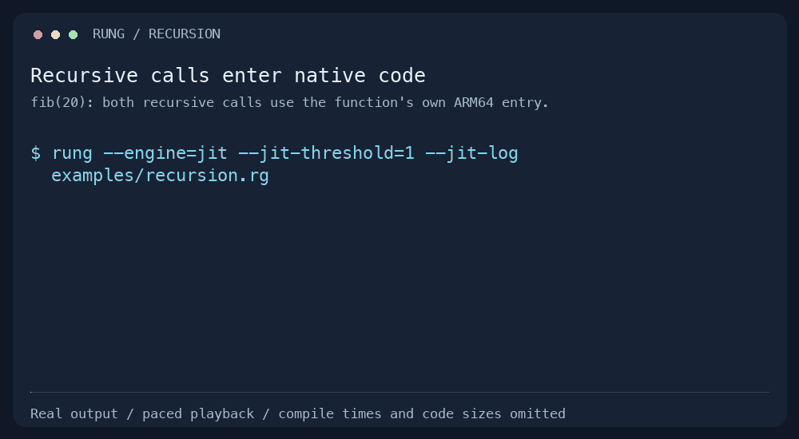

# Try Rung in a minute

[Back to Rung](../README.md)

The guided tour runs real programs and checks every answer. It needs Python 3.9+ and a Rung
binary. It does not run benchmarks or require a quiet machine.

```sh
python3 scripts/demo.py --rung build/debug/rung
```

With an ARM64 JIT build, the same command also demonstrates native compilation and fallback:

```sh
python3 scripts/demo.py --rung build/release-goto-nanbox/rung
```

Use `--section engines`, `--section bytecode`, `--section jit`, or `--section recursion` to run just one part.
An unavailable JIT is explicitly skipped; the interpreter and bytecode demonstrations still run.

## One program, the same answer

[hot_loop.rg](../examples/hot_loop.rg) calls the same integer loop twice. The tour compares
stdout against `994657` on both calls, using every available configuration: tree-walker, stack
VM, register VM, synchronous JIT and background JIT. The background compiler may finish before
or after the second call; either schedule must produce the same answer.



[Still image](assets/engines.png) · [Text transcript](assets/demo-transcript.md)

## See why the bytecode changes

[bytecode.rg](../examples/bytecode.rg) defines `add(a, b) { return a + b; }`. The stack VM pushes
two operands before adding them. The register VM names both operands directly in one `ADD`.
The tour shows the function excerpt from each actual disassembly and checks that both programs
print `42`. These are instruction representations, not a speed measurement.



[Still image](assets/bytecode.png) · [Text transcript](assets/demo-transcript.md)

## Watch the JIT compile and fall back

The hot-loop example uses the default threshold. Its first call heats up the function; its
second enters compiled ARM64 code. Then [jit_fallback.rg](../examples/jit_fallback.rg) uses a
threshold of one to make a tiny function compile immediately:

```sh
./build/release-goto-nanbox/rung --engine=jit --jit-log examples/hot_loop.rg
./build/release-goto-nanbox/rung --engine=jit --jit-threshold=1 --jit-log examples/jit_fallback.rg
```

The first addition receives integers and returns `42`. The second receives a float. The
generated code's integer guard fails before writing the result, so it returns a bytecode
position to the VM. The VM continues the same call and prints `22.5`.



[Still image](assets/jit.png) · [Text transcript](assets/demo-transcript.md)

## Recursive calls and nested fallback

[recursion.rg](../examples/recursion.rg) computes `fib(20)`, printing `6765`. With a threshold
of one, the first invocation compiles and both recursive calls branch to the same native entry.
Each native call pushes an ordinary VM frame, so the VM can recover if a later guard fails.

[recursive_fallback.rg](../examples/recursive_fallback.rg) first calls `tally(4, 1)`, then
`tally(4, 0.5)`. The float reaches an integer addition only in the innermost call. Native code
unwinds its machine stack while preserving the VM frames, and the VM resumes at that addition.
It finishes the five frames and prints `6.5`; no earlier work is repeated.

```sh
python3 scripts/demo.py --rung build/release-goto-nanbox/rung --section recursion
```



[Still image](assets/recursion.png) · [Text transcript](assets/demo-transcript.md)

This section requires the source revision with self-recursion support; it is not included in
the v0.1.0 archives.

The clips are generated from checked command output on ARM64. Compile durations and native code sizes
(which depend on embedded addresses and the build) are omitted. Frames are paced for reading. stdout and stderr are shown separately, not as an execution
timeline. The [capture](assets/demo.json) records the build version, platform and example hashes.

## Regenerate the clips

No screen recording is needed. Run this from the repository root on ARM64 with a JIT build:

```sh
python3 scripts/demo.py --rung build/release-goto-nanbox/rung --capture docs/assets/demo.json
python3 scripts/render_demo.py
```

Only the renderer needs [Pillow](https://pillow.readthedocs.io/) and a monospace font. It finds
Menlo on macOS or DejaVu Sans Mono on Linux; use `--font /path/to/font.ttf` for another font.
Rendering fails if the captured examples no longer match their source hashes. The output
includes GIFs, still PNGs and a Markdown transcript, so the demonstration is also readable
without animation.

CTest runs the tour with `--check-capture docs/assets/demo.json`, comparing the displayed output
with the committed capture for every configuration available in that build. A changed example
or disassembly therefore requires refreshing the clips. CI also checks the results chart with
`python3 scripts/render_results.py --check`.
